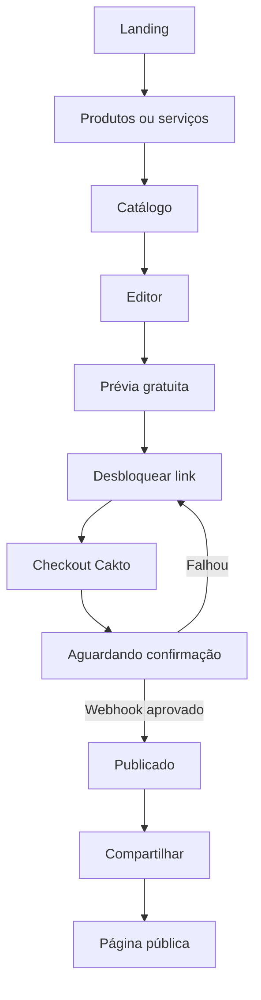

# Cadernô Express — Bíblia visual e funcional do frontend

**Status:** especificação de implementação para o agente.  
**Produto:** miniferramenta low ticket de mensagens digitais compartilháveis.  
**Princípio:** o cliente personaliza e pré-visualiza gratuitamente; somente a publicação de uma URL pública é paga.  
**Referência visual principal:** `assets/branding-aprovada.png` (imagem selecionada pelo usuário; não substituir por outra geração).  
**Referências complementares:** `assets/16-templates-referencia.png` e `assets/icones-status-3d.png`.

## 0. Instrução prioritária para o agente

Implementar TODO o frontend com fidelidade visual à referência aprovada. Não redesenhar a marca, não trocar o símbolo, não mudar a paleta, não usar componentes padrão que descaracterizem a interface. Os exemplos de telas adicionais são guias de fluxo, mas a **imagem principal é a fonte de verdade para branding**; a grade de 16 templates é a fonte de verdade para a **anatomia das mensagens**; e a grade de ícones é a fonte de verdade para as **ilustrações de status**.

Em caso de conflito: (1) comportamento validado e segurança; (2) branding principal; (3) anatomia dos 16 templates; (4) prancha complementar; (5) decisões técnicas do agente. Não declarar nenhuma tela concluída antes da conferência visual e funcional.

## 1. Posicionamento e público

- Promessa: **Transforme momentos em mensagens especiais.**
- Frase de marca: **Pequenas mensagens. Grandes conexões.**
- Público: pequenos comércios, lojas, prestadores de serviços e profissionais autônomos.
- Tom: humano, direto, acolhedor, profissional e simples. Mensagens curtas e legíveis em português brasileiro.
- O produto não é banco, sistema de cobrança automática, WhatsApp oficial nem plataforma de disparo em massa.
- A Cakto recebe **o pagamento pela publicação do cartão**. Campos Pix/cobrança exibidos *dentro de um template* pertencem ao negócio que está criando a mensagem; não são a cobrança da Cakto.
- Não criar login ou painel complexo no primeiro MVP. O fluxo deve funcionar imediatamente para visitantes.

## 2. Marca que não pode ser alterada

### 2.1 Logo

- Nome exato: `cadernô` com circunflexo no `ô`, todo em minúsculas.
- Assinatura `EXPRESS` em cápsula verde-petróleo com letras claras e espaçamento ampliado.
- Símbolo: duas folhas/cartões sobrepostos, camada posterior verde-petróleo, camada frontal coral com canto dobrado, três pequenos traços de brilho azul-noite.
- Formas simples, bordas arredondadas e sem efeitos 3D no próprio logo.
- Entregar versões horizontal, compacta, monocromática escura e branca, ícone quadrado e favicon. O SVG final deve ser vetorial real, não screenshot recortado.
- Manter áreas de respiro de no mínimo a altura da letra `c` ao redor da assinatura.

### 2.2 Tokens cromáticos

| Token | Valor | Uso |
|---|---|---|
| `brand.ink` | `#24324A` | Logo, títulos, texto forte |
| `brand.teal` | `#168A80` | Marca, controles selecionados, decorações |
| `brand.tealAction` | `#0F786F` | CTA com texto branco; contraste melhor que o teal principal |
| `brand.paper` | `#FFF9F0` | Fundo geral |
| `brand.coral` | `#F47D71` | Detalhes e marca, não texto pequeno sobre branco |
| `brand.mint` | `#E1F3EF` | Superfícies secundárias, destaques suaves |
| `surface.white` | `#FFFFFF` | Formulários e cartões |
| `text.secondary` | `#5A687A` | Explicações |
| `border.soft` | `#E7E8E4` | Bordas leves |
| `feedback.danger` | `#E53950` | Atraso/erro contextual |
| `feedback.warning` | `#F97316` | Vencimento e atenção |
| `feedback.success` | `#0F786F` | Confirmado |
| `feedback.blue` | `#2563EB` | Serviço/compra contextual |
| `feedback.purple` | `#7950E8` | Celebrações e promoções |

**Regra:** o produto mantém o shell creme/azul/teal. Roxo, laranja, azul intenso e vermelho aparecem apenas nos elementos semânticos de cada template; não substituem o verde principal do aplicativo.

### 2.3 Tipografia

- Interface: **Plus Jakarta Sans** em títulos e **DM Sans** em texto, campos e botões.
- Escala sugerida: título principal 32/38, título de tela 24/30, título de seção 20/26, corpo 16/24, label 14/20, metadado 12/16.
- Peso 700 para títulos, 500–600 para botões e labels, 400 para corpo.
- Mensagens dentro dos cartões podem ter fonte expressiva específica do template, mas a parte operacional do card permanece legível e consistente.
- Evitar texto com menos de 12 px em UI real. O horário decorativo somente aparece se houver valor real disponível.

### 2.4 Espaçamento e superfícies

- Unidade base 4 px; escala: 4, 8, 12, 16, 20, 24, 32, 40, 48, 64.
- Padding principal no mobile 20–24 px; entre cards do catálogo 12 px.
- Raio dos cards 20–24 px; botões 14–16 px; chips 999 px; inputs 12–14 px.
- Sombras discretas: `0 6px 24px rgba(36,50,74,.08)`; nunca glow saturado.
- Fundo creme, cards brancos, muito espaço negativo, ícones redondos discretos e cabeçalho leve.
- Botão principal `brand.tealAction`, texto branco e altura mínima de 48 px.
- Estado de foco claramente visível; alvos de toque ao menos 44x44 px; respeitar safe area do celular.

## 3. Regra de ouro dos cartões (16 templates)

Cada cartão segue a anatomia da referência `16-templates-referencia.png`:

1. Header opcional com mini marca do negócio / voltar; não inventar marca do destinatário.
2. **Faixa superior pastel de status** com a ilustração 3D grande e centralizada.
3. Bloco branco arredondado levemente sobreposto à faixa superior.
4. Saudação personalizada e título com hierarquia clara.
5. Mensagem breve sem texto microscópico.
6. Linhas de informações estruturadas com mini ícones e valores (quando o tipo permitir).
7. CTA largo e contextual. Sem destino configurado, não mostrar botão que não funciona.
8. Metadado pequeno no canto inferior direito quando houver informação real.

**Proibido:** status sobreposto ao título; ícone 3D abaixo do título; trocar ilustração glossy por emoji; template reduzido a texto sobre fundo colorido; detalhes desalinhados; CTAs sem ação; todos os 16 modelos visualmente idênticos; conteúdo falso apresentado como real.

### 3.1 Mapeamento imutável das 16 ilustrações

A imagem `icones-status-3d.png` tem **4 colunas × 4 linhas**. A ordem abaixo é leitura da esquerda para a direita, de cima para baixo. Recortar/exportar como 16 assets individuais de qualidade preservada, com fundo transparente quando existir, nomes estáveis e dimensões consistentes. Não regenerar desenhos diferentes.

| ID | Template | Ícone e posição no grid | Segmento | Cor/superfície |
|---|---|---|---|---|
| `boas-vindas` | Boas-vindas | Mão amarela, L1 C1 | Ambos | menta clara |
| `agradecimento-compra` | Agradecimento pela compra | Sacola azul com coração, L1 C2 | Produtos | azul claro |
| `parcela-proxima` | Parcela próxima do vencimento | Calendário verde, L1 C3 | Ambos | menta |
| `parcela-hoje` | Parcela vence hoje | Calendário laranja, L1 C4 | Ambos | creme/laranja |
| `parcela-atrasada` | Lembrete de parcela em aberto | Alerta vermelho, L2 C1 | Ambos | rosa claro |
| `cobranca-pix` | Cobrança Pix | Recibo/QR, L2 C2 | Ambos | menta |
| `pagamento-confirmado` | Pagamento confirmado | Check verde, L2 C3 | Ambos | menta |
| `caderneta-quitada` | Caderneta quitada | Troféu dourado, L2 C4 | Ambos | creme/dourado |
| `servico-contratado` | Serviço contratado | Prancheta azul, L3 C1 | Serviços | azul claro |
| `servico-concluido` | Serviço concluído | Selo verde, L3 C2 | Serviços | menta |
| `aniversario` | Aniversário | Presente roxo, L3 C3 | Ambos | lilás claro |
| `produto-destaque` | Produto em destaque | Etiqueta roxa, L3 C4 | Produtos | lilás |
| `oferta-especial` | Oferta especial | Etiqueta laranja, L4 C1 | Ambos | pêssego |
| `novidades-colecao` | Novidades e coleção | Sacola verde, L4 C2 | Produtos | menta |
| `reativacao-cliente` | Reativação de cliente | Coração coral, L4 C3 | Ambos | rosa |
| `lembrete-aprovacao` | Lembrete com aprovação | Ampulheta laranja, L4 C4 | Serviços | pêssego |

**Catálogo:** separar em abas Produtos e Serviços. Alguns templates são compartilhados, mas textos/campos variam conforme o segmento. Não duplicar o mesmo conteúdo literalmente se a situação de serviço for diferente da de compra.

### 3.2 Variáveis e dados por família

- Comuns: `businessName`, `recipientName`, `title`, `message`, `templateId`, `segment`, `accentColor`.
- Compra: `productName`, `productImage?`, `purchaseAmount?`, `purchaseDate?`.
- Parcelas: `installmentAmount`, `dueDate`, `installmentNumber`, `installmentTotal`, `paymentLink?`.
- Pix: `pixCopyPaste`, `pixQrImage?`, `amount`, `dueDate?`; **não gerar um QR fictício para produção**.
- Serviço: `serviceName`, `servicePrice?`, `scheduledAt?`, `completionDate?`, `evaluationLink?`.
- Promoção: `offerName`, `oldPrice?`, `newPrice?`, `productImage?`, `offerLink?`, `validUntil?`.
- Mensagens pessoais: `occasion?`, `customGreeting?`, `actionLink?`.

O editor mostra **somente campos relevantes** para o template escolhido; o backend valida o esquema correspondente. Não pedir 15 campos a quem quer apenas desejar boas-vindas.

## 4. Todas as telas do MVP

| Código | Rota ou estado | Conteúdo/ações | Critério visual |
|---|---|---|---|
| `S01` | `/` Início | Hero, proposta, CTA, exemplos de cartões, prova do produto em uso | Igual à primeira tela aprovada |
| `S02` | `/criar` Segmento | Dois cards Produtos/Serviços, explicação simples, seguir | Ilustração 3D, cards simétricos |
| `S03` | `/templates?segment=product` | Busca/chips e grid dos templates de Produtos | Duas colunas no mobile, ícones 3D |
| `S04` | `/templates?segment=service` | Templates de Serviços e gerais, sem copy de varejo indevida | Mesma UI, conteúdo específico |
| `S05` | `/templates/:templateId` | Detalhe com exemplo ampliado, descrição, CTA Usar modelo | Prévia real e destaque do ícone |
| `S06` | `/editar/:draftId` | Formulário contextual, autosave informado, preview pequeno | Inputs claros e card real |
| `S07` | `/previa/:draftId` | Visualização gratuita sem controles de edição dentro do cartão; editar/desbloquear | Formato idêntico ao destinatário |
| `S08` | `/publicar/:draftId` | Resumo do que será liberado, preço real configurado, CTA Cakto | Sem captura própria de cartão |
| `S09` | Estado checkout iniciado | Abrir checkout da Cakto; mensagem de retorno à aba e consulta de status | Continuidade calma, sem falsa aprovação |
| `S10` | `/pagamento/:draftId` pendente | Aguardando pagamento, atualização de status, voltar ao checkout | Loading acessível, sem prazo inventado |
| `S11` | Pagamento recusado/cancelado | Explicar com clareza, tentar novamente/retornar | Alerta discreto, ação útil |
| `S12` | `/sucesso/:draftId` | Mensagem publicada, URL, copiar, compartilhar | Check glossy verde e link em destaque |
| `S13` | Sheet de compartilhar | Copiar link, WhatsApp, compartilhamento nativo e fallback | Botões efetivos, responsivo |
| `S14` | `/m/:slug` | Página pública completa, somente cartão publicado | **Sem editor, preço, checkout ou conta** |
| `S15` | `/rascunhos` | Rascunhos deste navegador com continuar/abrir/excluir local | Simples; sem prometer backup de conta |
| `S16` | Link inválido/revogado | Mensagem amigável, sem expor dados privados | Estado vazio com branding |
| `S17` | Falha de rede/API | Tentar novamente, preservar campos locais | Sem perda silenciosa de conteúdo |
| `S18` | `/ajuda` | Passos de uso, pagamento, como compartilhar, suporte | FAQ objetivo |
| `S19` | `/termos` e `/privacidade` | Páginas legais reais, sem texto inventado pelo frontend | Tipografia de leitura |
| `S20` | 404 | Rota não encontrada e botão início | Marca consistente |

### 4.0.1 Pranchas de referência e versões desktop

Foram produzidas três pranchas complementares nesta conversa:

- **Prancha 01 (01–09):** início, escolha, catálogo, personalização, prévia, desbloqueio, aguardando pagamento, sucesso e destinatário.
- **Prancha 02 (10–18):** Serviços, detalhe do modelo, editores específicos, edição, pagamento recusado, rascunhos, link indisponível e ajuda.
- **Prancha 03 (19–22):** landing, catálogo, editor e página compartilhada em desktop. São variações responsivas das rotas, não quatro novas regras de negócio.

As pranchas geradas são **referências visuais, não fonte confiável de cópia ou dados**. Em particular:

- O texto de “Pagamento recusado” deve se referir à compra da publicação na Cakto, **não a uma parcela do cliente final**.
- O editor não pode exibir um botão “Compartilhar” operacional antes de o pagamento estar aprovado. Prévia grátis é permitida; publicar/compartilhar URL pública depende da confirmação.
- A tela pública não pode usar “Ver minha caderneta” ou outro CTA sem que um link válido tenha sido configurado pelo criador.
- A landing não pode inventar depoimentos, número de vendas, preço ou prova social.
- O editor de Cobrança Pix serve para criar **uma mensagem de cobrança fornecida pelo próprio negócio**; não inicia nem confirma transações bancárias do destinatário e não deve fabricar QR Code.
- Não reutilizar a mesma mensagem de produto em um serviço só por semelhança do layout.

### 4.1 Estados obrigatórios de todos os componentes

- Loading/skeleton com tamanho estável; sem pular layout.
- Vazio (sem modelos da busca, sem rascunhos).
- Erro de validação por campo com mensagem e foco.
- Salvando / salvo / falha ao salvar.
- CTA desabilitado com explicação do que falta.
- Copiado para área de transferência com feedback real.
- Webhook ainda pendente após retorno do checkout.
- Publicação disponível, revogada ou não encontrada.
- Sem conexão e tentativa posterior sem descartar edição.

## 5. Wireflow funcional e regras de acesso



O fluxo deve funcionar sem login. A URL pública não existe enquanto o status não for `published`. A página pública não pode exibir rascunhos não pagos, mesmo com URL adivinhada.

## 6. Arquitetura de frontend

**Recomendação:** Next.js com React + TypeScript, pois a página `/m/:slug` deve oferecer metadados Open Graph por publicação (título, descrição e imagem de prévia) quando o link for compartilhado. O backend Fastify existente continua separado, atendendo as rotas `/api/...`. Não colocar regra de pagamento nos componentes nem duplicar lógica da Cakto no browser.

Estrutura sugerida, sem cerimônia excessiva:

```text
src/
  domain/
    message/              tipos e regras puras de apresentação do conteúdo
  application/
    drafts/               casos de uso: criar, atualizar, consultar status
    publication/          controle do fluxo e estados
    contracts/            portas realmente necessárias
  infrastructure/
    http/                 cliente Fastify API e serialização
    local/                rascunhos acessíveis neste dispositivo
  presentation/
    app/                  páginas e rotas Next.js
    components/
      brand/              Logo, Header, BrandMark
      templates/          16 variações de cartão e status
      editor/             FormFields, LivePreview, AutosaveStatus
      catalog/            SegmentTabs, FilterChips, TemplateTile
      payment/            UnlockPanel, PaymentStatus
      share/              ShareSheet, CopyButton, PublicLink
      ui/                 controles base de design system
    styles/               tokens, fontes e temas
public/
  branding/               logos SVG e ícones de marca
  templates/status/       16 imagens 3D individuais
```

Não usar Ant Design padrão ou uma biblioteca de UI inteira com aparência genérica se isso comprometer a fidelidade; o conjunto de componentes é pequeno o suficiente para um design system leve próprio.

### 6.1 Responsividade

- 320–430 px: mobile-first. Grid 2 colunas no catálogo onde a largura permitir; editor de uma coluna, CTA fixo apenas quando não cobrir conteúdo.
- 431–767 px: mobile amplo, mais respiro.
- 768–1023 px: tablet com catálogo de 3 colunas e editor + prévia lado a lado quando couber.
- 1024+ px: catálogo 4 colunas, editor e preview em duas colunas, conteúdo centralizado; **não esticar o cartão de mensagem** além do aspecto mobile.
- Página `/m/:slug` centraliza um cartão com largura máxima ~420 px e mantém o desenho do mobile em desktop.
- Usar `prefers-reduced-motion`, foco visível, alt text e textos com contraste mínimo WCAG AA; não usar o coral claro com branco em textos pequenos.

## 7. Integração exata com o backend existente

| Ação frontend | Contrato atual |
|---|---|
| Criar | `POST /api/drafts` → `id`, `editToken`, `status`, `content` |
| Prévia/recuperar | `GET /api/drafts/:id` com `X-Edit-Token` |
| Salvar edição | `PUT /api/drafts/:id` com `X-Edit-Token` |
| Iniciar pagamento | `POST /api/drafts/:id/checkout` → `checkoutUrl` |
| Consultar confirmação | `GET /api/drafts/:id/status` → `status`, `publicUrl` |
| Página pública | `GET /api/publications/:slug` → `content` |

**Lacuna conhecida:** o backend v0.1 guarda `segment`, `templateId`, `businessName`, `recipientName`, `title`, `message`, `accentColor`, mas ainda **não** tem os campos estruturados de parcelas, produtos, serviços, Pix e promoções. Evoluir o domínio e o schema da API com TDD antes de considerar os 16 templates funcionais. Não preencher com dados fictícios em produção. Para preço de publicação, consultar oferta/configuração real; não hardcodar preço inventado no frontend.

**Cakto:** pagamento é externo e a confirmação é servidor-servidor. Não liberar o link pela página de obrigado, URL de redirect ou pela resposta de abrir checkout. A tela S10 consulta o status até confirmação; se o usuário fechar a aba, ao reabrir o rascunho poderá consultar novamente.

**Compartilhamento:** `navigator.share` quando existir; copiar URL como fallback; link WhatsApp com texto e URL, sem enviar automaticamente mensagem em nome do usuário. O destinatário abre `/m/:slug` sem login. Os metadados Open Graph não devem conter conteúdo privado de rascunhos.

## 8. Componentes que o agente precisa entregar

- `BrandLogo` horizontal/compacto, `AppHeader`, `MobileNavigation` e `Footer`.
- `PrimaryButton`, `SecondaryButton`, `IconButton`, `TextField`, `Textarea`, `Select`, `Checkbox`, `Toast`, `Dialog`, `BottomSheet`, `Skeleton`, `ErrorState`, `EmptyState`.
- `SegmentSwitcher`, `TemplateFilters`, `TemplateCard`, `StatusIllustration`, `TemplatePreview`.
- `MessageCard` com blocos `StatusHero`, `Greeting`, `MessageBody`, `DetailRows`, `ContextAction`, `MessageTimestamp`.
- `DraftEditor` por configuração de template, `LivePreview`, `SaveIndicator`.
- `UnlockPublicationPanel`, `PaymentPending`, `PaymentError`, `PublicationSuccess`, `ShareActions`.
- `PublicMessagePage` e `UnavailablePublication`.

Os componentes visuais só renderizam estado e capturam ação. Adapters HTTP ficam em infrastructure; casos de uso em application; domínio livre de Next.js/React.

## 9. Testes e critérios de aceite

### 9.1 Visual

- [ ] Logo e paleta conferidos lado a lado com `branding-aprovada.png`.
- [ ] 16 cards com ícone 3D correto, dimensão coerente e ordem do grid confirmada.
- [ ] Status sempre **acima** do título em todos os cartões.
- [ ] Todos os cards possuem saudação, corpo, detalhes condicionais, CTA real e horário apenas quando disponível.
- [ ] Componentes preservam cantos, tipografia, grid e respiro da referência.
- [ ] Screenshots comparativos de 360×800, 390×844, 430×932, 768×1024 e 1440×900.
- [ ] Nenhuma tela apresenta scroll horizontal, texto cortado, CTA fora de alcance ou clipping da ilustração.
- [ ] `Produtos` e `Serviços` exibem coleções e textos próprios, sem reutilização indevida.

### 9.2 Funcional

- [ ] Criar → editar → recarregar → restaurar rascunho do dispositivo.
- [ ] Preview gratuito corresponde à página publicada no design.
- [ ] Antes do pagamento, `/m/:slug` não revela o conteúdo.
- [ ] Checkout é hospedado na Cakto; API secret nunca chega ao navegador.
- [ ] Status `awaiting_payment` não é mostrado como sucesso.
- [ ] Webhook aprovado permite publicar e copiar URL; teste de evento falso não publica.
- [ ] Evento de reembolso/chargeback torna a URL indisponível.
- [ ] Botões copiar, compartilhar, voltar e tentar novamente têm ações reais.
- [ ] Testar carregamento lento, sem conexão, URL inválida e pagamento recusado.
- [ ] Verificar teclado, leitor de tela, contraste e estados de foco.
- [ ] Eventos de marketing só são marcados como conversão quando a compra realmente for confirmada; respeitar configuração de privacidade.

### 9.3 Evidência mínima de entrega

O agente deve apresentar:

1. Storybook ou galeria interna dos componentes e dos 16 cartões.
2. Capturas de todas as telas obrigatórias em mobile e desktop.
3. Comparação visual lado a lado com as três referências de origem.
4. Resultado dos testes unitários, integração e E2E essenciais.
5. Lista de diferenças remanescentes, se houver; não dizer “pixel-perfect” sem verificação.
6. Lista de itens pendentes de serviços externos (oferta Cakto, HTTPS, Meta, e-mail, etc.) sem simular integração real.

## 10. Ordem de implementação orientada por comportamento/TDD

1. Definir contratos dos dados por template e fluxos de estado.
2. Criar testes para as regras de cada família e autorização da publicação.
3. Estender backend para detalhes estruturados onde faltar.
4. Implementar tokens, fontes, logo vetorial e componentes de base.
5. Implementar o `MessageCard` e as 16 variações com imagens originais.
6. Construir landing, segmento, catálogo e detalhe.
7. Construir editor contextual, salvar e prévia fiel.
8. Conectar checkout Cakto e status de publicação.
9. Construir sucesso, compartilhamento e página pública SSR/OG.
10. Completar estados de erro, ajuda, termos, privacidade e responsividade.
11. Executar auditoria visual e E2E; corrigir diferenças.
12. Somente então preparar deploy Hostinger.

## 11. Instrução final para o agente

**Não conclua apenas porque todas as rotas existem.** O projeto só está pronto quando cada interação funciona, os 16 templates têm o layout e as ilustrações esperadas, o fluxo de pagamento não libera conteúdo indevidamente e as telas se parecem visualmente com a identidade aprovada em mobile real. Não invente dados de pagamento, preço, datas, métricas ou integrações. Regra de negócio no domínio, UI na apresentação, dependências externas por adaptadores. A implementação deve ser mais simples de entender, testar e evoluir — não apenas mais abstrata.
